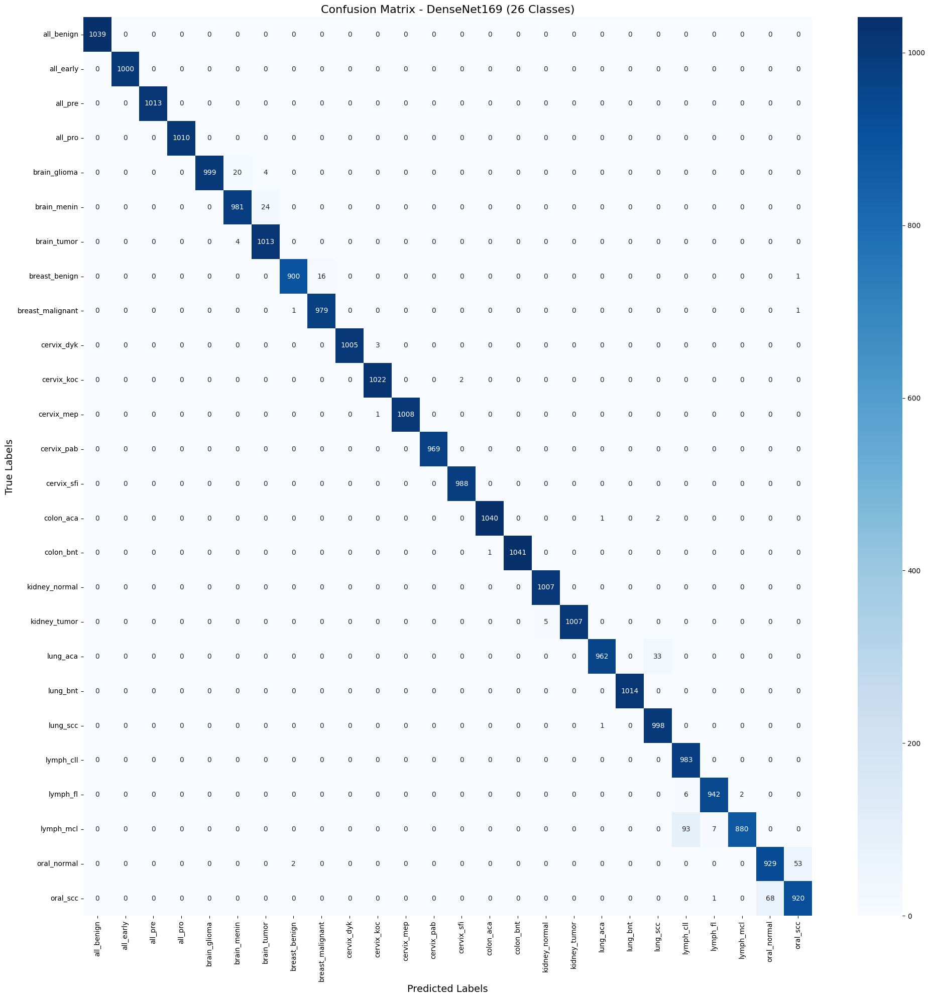

# Multi-Cancer Classification using DenseNet169
An end-to-end Deep Learning project that classifies 26 different subclasses of cancer from medical images. The model utilizes transfer learning with a pre-trained **DenseNet169** architecture, achieving an outstanding validation accuracy of **99%**.

## 📊 Dataset Overview
The dataset contains **130,002 images** categorized into **26 distinct classes** encompassing various types of cancer (e.g., Brain Tumor, Breast Malignant, Colon Adenocarcinoma, Lung Squamous Cell Carcinoma, etc.).

**Dataset Source:** [Download from Kaggle](https://www.kaggle.com/datasets/obulisainaren/multi-cancer)

- **Input Size:** Resized to 224x224 pixels.
- **Normalization:** ImageNet standards `(mean=[0.485, 0.456, 0.406], std=[0.229, 0.224, 0.225])`.
- **Split:** 80% Training, 20% Validation.

## 🧠 Model & Training Strategy
The project leverages a **Two-Phase Fine-Tuning Strategy** to optimize the DenseNet169 model without destroying the pre-trained ImageNet weights:


- **Phase 1 (Classifier Training):** 
  - Frozen all feature extraction layers.
  - Trained only the fully connected classifier layer for 3 epochs.
  - *Optimizer:* Adam (lr = 1e-3).
- **Phase 2 (Deep Fine-Tuning):** 
  - Unfrozen the last dense block (`denseblock4`) and the final normalization layer (`norm5`).
  - Trained for an additional 2 epochs with a lower learning rate to capture domain-specific medical features.
  - *Optimizer:* Adam (lr = 1e-5 for features, 1e-4 for classifier).
 
## 📈 Results & Performance
The model demonstrated robust performance across all 26 classes, handling class variations effectively.
- **Final Validation Accuracy:** ~99.05%
- **Macro F1-Score:** 0.99

> **Note:** A detailed confusion matrix plot is generated in the notebook to visualize true vs. predicted labels.


## ⚙️ Requirements
- Python 3.13+
- PyTorch & Torchvision
- Pandas & Numpy
- Pillow (PIL)
- Scikit-learn
- Matplotlib & Seaborn
- tqdm


## 🚀 Usage

You can view the full code in [notebook](notebooka45780a5bf.ipynb)

1. Clone the repository:
   ```bash
   git clone https://github.com/Abo3adel/multi-cancer-classification.git
   cd multi-cancer-classification
   ```
2. Update the data_dir path in the notebook to point to your local or Kaggle dataset directory.

3. Run the Jupyter Notebook cells sequentially to train the model and generate the evaluation metrics.
